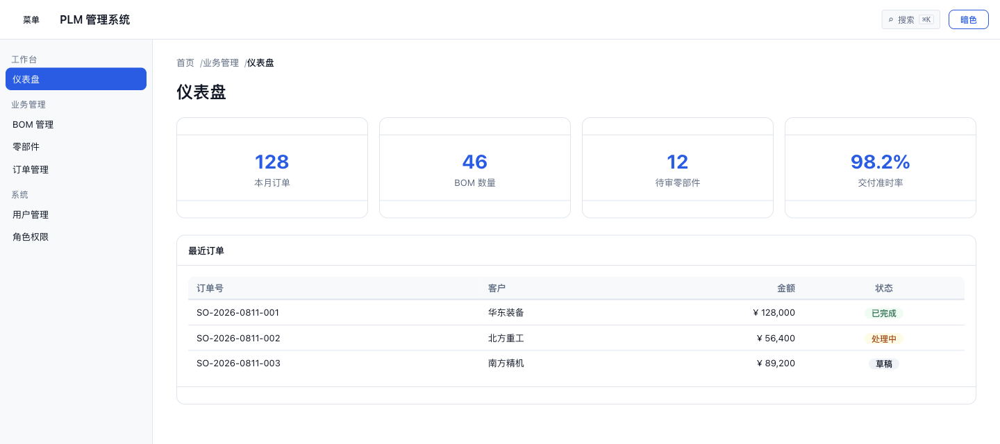

# zAgentUI

**Web Components component library — 134 components, zero runtime dependencies.**

[简体中文](README.zh-CN.md) · **[Live demo](https://zwebui.haoyongde.com)** · **[npm](https://www.npmjs.com/package/@cpsoft13/z-agent-ui)**



Native Custom Elements. Works in React, Vue, Svelte, or plain HTML — the same markup, no adapter required.
Form controls, tables, charts, Gantt, flow editor, document templates, app shell, and a mobile set (`m-*`) that
follows the same tokens.

This repository contains **layers L0–L2**:

| Layer | Contents | What it is |
|---|---|---|
| L0 | `core` · `primitives` · `theme` | Template, escaping, focus trap, floating positioning, design tokens |
| L1 | `components` | Single-purpose controls. They don't know where data comes from |
| L2 | `report` · `flow` · `doc` · `content` · `property` · `app` | Composite parts with their own domain model (rows, nodes, timeline, blocks) |

The page engine (`z-page-view`, the script language, the router, the page registry) is a separate package —
see **[z-agent-page](https://gitee.com/cpsoft13/z-agent-page)**. It depends on this library, never the other way around.

---

## Install

```bash
npm install @cpsoft13/z-agent-ui
```

```js
// Style entry: every token, three densities, dark theme included
import "@cpsoft13/z-agent-ui/z-agent-ui.css";

// Components register themselves on import — one directory entry per component
import "@cpsoft13/z-agent-ui/components/button";
```

```html
<z-button variant="primary">保存</z-button>
```

Each domain also has a barrel entry if you want the whole set at once:

```js
import "@cpsoft13/z-agent-ui/report";     // table + chart + gantt + data-list
import "@cpsoft13/z-agent-ui/flow";       // flow canvas
import "@cpsoft13/z-agent-ui/doc";        // document templates
import "@cpsoft13/z-agent-ui/app";        // app shell, login, detail form, print
```

---

## Entry points

| Import | Registers |
|---|---|
| `@cpsoft13/z-agent-ui/components/<name>` | one control (`button`, `select`, `table`, `tree`, …) |
| `@cpsoft13/z-agent-ui/primitives` | overlay / portal / focus primitives |
| `@cpsoft13/z-agent-ui/report` | `z-report-table`, `z-chart`, `z-gantt`, `z-data-list` |
| `@cpsoft13/z-agent-ui/report/card` | a single report card (no board container) |
| `@cpsoft13/z-agent-ui/report/core` | pure-TS kernel: aggregation, grouping, formatting, layout |
| `@cpsoft13/z-agent-ui/flow` | `z-flow` node canvas |
| `@cpsoft13/z-agent-ui/doc` | `z-doc-template` editor / preview / manager |
| `@cpsoft13/z-agent-ui/content` | markdown / code editor / rich content renderers |
| `@cpsoft13/z-agent-ui/property` | property panel, group, row — the inspector shell |
| `@cpsoft13/z-agent-ui/app` | app shell, nav, login, detail form, print |
| `@cpsoft13/z-agent-ui/react` | typed React wrappers over every element |
| `@cpsoft13/z-agent-ui/locales/<locale>` | language packs (`zh-CN` default built-in, `en-US`, …) |

---

## Internationalization (i18n)

Default locale is `zh-CN` (zero configuration for Chinese apps). Switch languages at runtime with one call — connected components update automatically while preserving any host-overridden attributes:

```js
import { setLocale } from "@cpsoft13/z-agent-ui";
import enUS from "@cpsoft13/z-agent-ui/locales/en-US";

setLocale("en-US", enUS);
```

Number and date formatters (`fmt.number`, `fmt.percent`, `fmt.date`) follow the active locale via `Intl`.

---

## Theming

One stylesheet, two themes, three densities. Everything is a CSS custom property:

```css
:root {
  --z-color-primary: #2563eb;
  --z-radius-md: 8px;
  --z-space-4: 16px;
}
```

Dark mode is `[data-theme="dark"]` on any ancestor. Density is `[data-density="compact|cozy|spacious"]`.
Component-level hooks (`--z-select-placeholder-color`, `--m-coupon-cut`, …) let a page restyle one instance
without touching the global tokens.

---

## What "zero runtime dependencies" means here

`dependencies` is empty. `react` / `react-dom` / `marked` are optional peers — only the React wrapper and the
markdown renderer need them, and the main entry imports neither. A guard fails the build if a new external
import appears without an expiry date and a plan to remove it.

---

## Machine-readable contract

`registry/component-manifest.json` lists every element — tag, source file, layer, attributes, events, slots.
It is generated from source and verified by a guard, so it cannot drift:

```bash
npm run manifest        # regenerate
npm run manifest:check  # fail if source and manifest disagree
```

Consumers (including AI agents writing page definitions) read this file instead of guessing attribute names.
134 components / 959 attributes in the current build.

---

## Develop

```bash
npm install
npm run dev          # demo site at http://localhost:5173
npm test             # 2874 unit tests
npm run check        # exports / manifest / motion / layer / lines
npm run check:guards # 40+ structural guards, all must pass
npm run build        # dist/ + type declarations
```

Guards worth knowing about:

| Guard | Catches |
|---|---|
| `layer:check` | L0–L2 dependency direction, files outside any layer |
| `theme-token-guard` | a `var(--token)` that no stylesheet defines |
| `l1-escape-guard` | hand-written `&` → `&amp;` instead of the single `escapeAttr` |
| `demo-coverage-guard` | a component with no demo example and no stated reason |
| `brand-guard` | the package name hard-coded into logic instead of read from `package.json` |

---

## License

MIT
