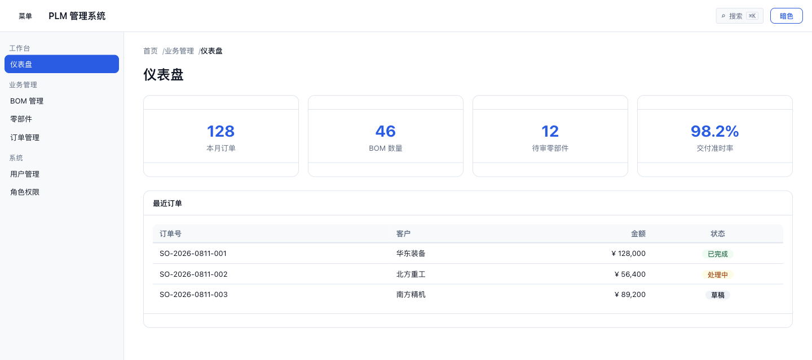

# zAgentUI

**Web Components 组件库 —— 134 个组件，零运行时依赖。**

[English](README.md) · **[在线演示](https://zwebui.haoyongde.com)** · **[npm](https://www.npmjs.com/package/@cpsoft13/z-agent-ui)**



原生 Custom Elements。React / Vue / Svelte / 纯 HTML 都是同一套标签，不需要适配层。
表单控件、表格、图表、甘特、流程图、文档模板、应用外壳，以及一套沿用同样令牌的移动端组件（`m-*`）。

本仓库是 **L0–L2 三层**：

| 层 | 目录 | 是什么 |
|---|---|---|
| L0 | `core` · `primitives` · `theme` | 模板、转义、焦点陷阱、浮层定位、设计令牌 |
| L1 | `components` | 只做一件事的控件，不知道数据从哪来 |
| L2 | `report` · `flow` · `doc` · `content` · `property` · `app` | 带领域模型的复合件（行 / 节点 / 时间轴 / 块） |

页面引擎（`z-page-view`、页面脚本语言、路由、页面注册表）是另一个包 ——
见 **[z-agent-page](https://gitee.com/cpsoft13/z-agent-page)**。它依赖本库，依赖方向单向。

---

## 安装

```bash
npm install @cpsoft13/z-agent-ui
```

```js
// 样式入口：全部令牌、三档密度、暗色主题
import "@cpsoft13/z-agent-ui/z-agent-ui.css";

// 组件在 import 时自己注册 —— 一个组件一个目录入口
import "@cpsoft13/z-agent-ui/components/button";
```

```html
<z-button variant="primary">保存</z-button>
```

想一次引入整域也可以：

```js
import "@cpsoft13/z-agent-ui/report";     // 表格 + 图表 + 甘特 + 数据列表
import "@cpsoft13/z-agent-ui/flow";       // 流程画布
import "@cpsoft13/z-agent-ui/doc";        // 文档模板
import "@cpsoft13/z-agent-ui/app";        // 应用外壳、登录、详情表单、打印
```

---

## 入口

| 引入 | 注册什么 |
|---|---|
| `@cpsoft13/z-agent-ui/components/<name>` | 单个控件（`button` / `select` / `table` / `tree` …） |
| `@cpsoft13/z-agent-ui/primitives` | 浮层 / 传送门 / 焦点原语 |
| `@cpsoft13/z-agent-ui/report` | `z-report-table`、`z-chart`、`z-gantt`、`z-data-list` |
| `@cpsoft13/z-agent-ui/report/card` | 只要一张报表卡，不拖进看板容器 |
| `@cpsoft13/z-agent-ui/report/core` | 纯 TS 内核：聚合、分组、格式化、布局 |
| `@cpsoft13/z-agent-ui/flow` | `z-flow` 节点画布 |
| `@cpsoft13/z-agent-ui/doc` | `z-doc-template` 编辑器 / 预览 / 管理 |
| `@cpsoft13/z-agent-ui/content` | markdown / 代码编辑器 / 富内容渲染 |
| `@cpsoft13/z-agent-ui/property` | 属性面板、分组、行 —— 检查器外壳 |
| `@cpsoft13/z-agent-ui/app` | 应用外壳、导航、登录、详情表单、打印 |
| `@cpsoft13/z-agent-ui/react` | 每个元素对应的类型化 React 包装器 |

---

## 主题

一份样式表，两套主题，三档密度。全部是 CSS 自定义属性：

```css
:root {
  --z-color-primary: #2563eb;
  --z-radius-md: 8px;
  --z-space-4: 16px;
}
```

暗色是任意祖先上的 `[data-theme="dark"]`，密度是 `[data-density="compact|cozy|spacious"]`。
组件级钩子（`--z-select-placeholder-color`、`--m-coupon-cut` 等）让页面只改某一个实例，
不动全局令牌。

---

## 「零运行时依赖」的边界

`dependencies` 是空的。`react` / `react-dom` / `marked` 是可选 peer —— 只有 React 包装器与
markdown 渲染需要它们，主入口一个都不引。新增一个外部 import 而没有到期日与移除计划时，
守卫会让构建红。

---

## 机器可读的契约

`registry/component-manifest.json` 列出每个元素 —— 标签、源文件、层号、属性、事件、插槽。
它由源码生成、由守卫校验，所以不会漂移：

```bash
npm run manifest        # 重新生成
npm run manifest:check  # 源码与清单不一致就失败
```

消费方（包括写页面定义的 AI）读这份文件，而不是猜属性名。当前构建 134 个组件 / 959 个属性。

---

## 开发

```bash
npm install
npm run dev          # 演示站 http://localhost:5173
npm test             # 2874 条单测
npm run check        # exports / manifest / motion / layer / lines
npm run check:guards # 40+ 条结构守卫，全绿才算过
npm run build        # dist/ + 类型声明
```

几条值得知道的守卫：

| 守卫 | 抓什么 |
|---|---|
| `layer:check` | L0–L2 的依赖方向、不属于任何层的文件 |
| `theme-token-guard` | 引用了但没有任何样式表定义的 `var(--token)` |
| `l1-escape-guard` | 手写 `&` → `&amp;` 而不是用唯一的 `escapeAttr` |
| `demo-coverage-guard` | 没有示例、也没写理由的组件 |
| `brand-guard` | 把包名写进逻辑（应该从 `package.json` 读） |

---

## 协议

MIT
